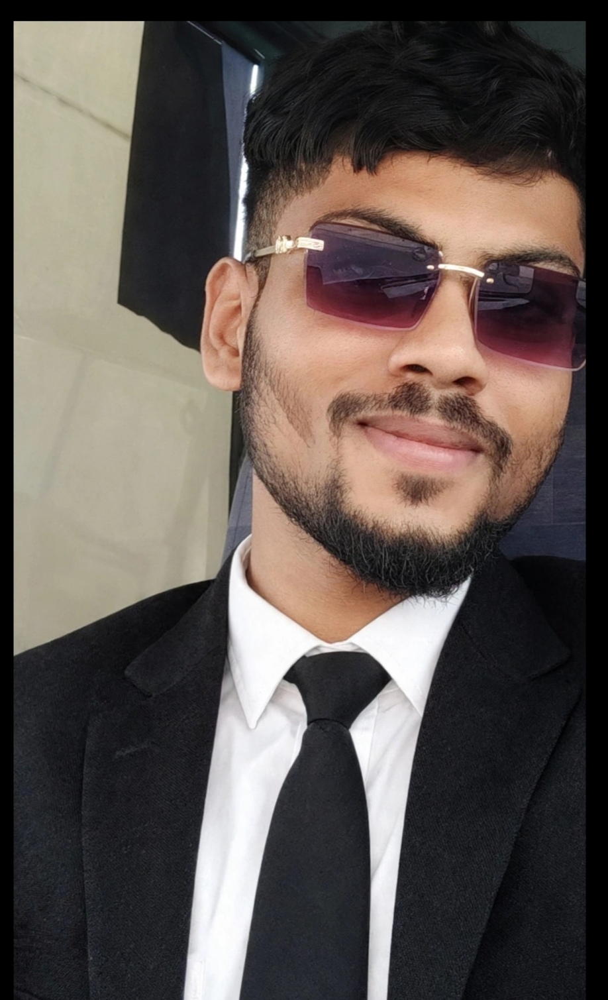
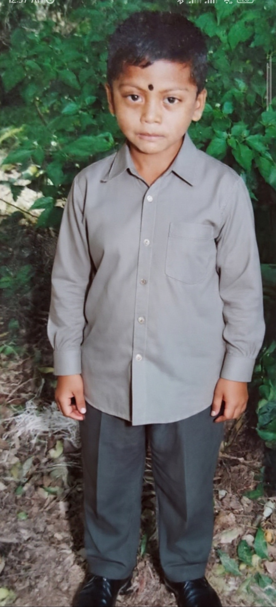
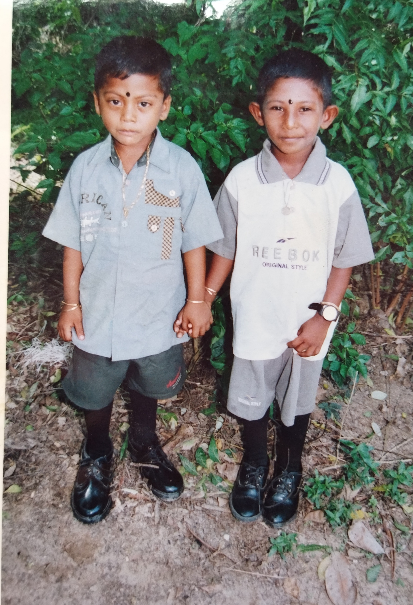

<html lang="en">
<head>
<meta charset="UTF-8">
<meta name="viewport" content="width=device-width, initial-scale=1.0">
<title>Nishanthan Suseekaran | Personal Website</title>
<meta name="description" content="Nishanthan Suseekaran's personal profile, education, work experience, family and dream of becoming a pilot.">

</head>

<body>

<header>
  
Nishanthan Suseekaran

  <nav>
    <a href="#home">Home</a>
    <a href="#about">About Me</a>
    <a href="#education">Education</a>
    <a href="#work">Work</a>
    <a href="#dream">My Dream</a>
    <a href="#family">My Family</a>
    <a href="#contact">Contact</a>
  </nav>
</header>

  

  <h1>Nishanthan Suseekaran</h1>
  
Welcome to My Personal Website

  
My Life • My Education • My Work • My Dreams

  
<strong>My Location:</strong>
    <a class="location-link"
       href="https://www.google.com/maps/search/?api=1&query=Kaluwanchikudy%2C+Batticaloa%2C+Sri+Lanka"
       target="_blank" rel="noopener noreferrer">
       Kaluwanchikudy, Batticaloa, Sri Lanka 📍
    </a>
  

  Dreaming of Becoming a Pilot ✈️

  

    <a class="button" href="#about">About Me</a>
    <a class="button" href="#dream">My Dream</a>
    <a class="button cv-button"
      href="CV_Nishan.pdf"
       download>Download My CV ↓</a>
  

  

    <strong>Contact Me</strong>
    
Email: <a href="mailto:nishanthan200102@gmail.com">nishanthan200102@gmail.com</a>

    
Phone: <a href="tel:+94756652873">+94756652873</a>

    
WhatsApp: <a
href="https://wa.me/+94756652873" target="_blank">
Chat on WhatsApp</a>

  

a
<main>

<section id="about">
  <h2>About Me</h2>
  
Hello! I'm Nishanthan Suseekaran, from Sri Lanka. My childhood dream is to become a pilot. Although I faced challenges and lacked opportunities and resources to study aviation, my dream is still alive. I continue learning step by step and working towards a better future.

  
This website shares my life, education, work experience, family memories and dreams.

  

    <strong>My Location</strong>
    
<a class="contact-link"
      href="https://www.google.com/maps/search/?api=1&query=Kaluwanchikudy%2C+Batticaloa%2C+Sri+Lanka"
      target="_blank" rel="noopener noreferrer">
      Kaluwanchikudy, Batticaloa, Sri Lanka — Open Google Maps 📍
    </a>

  

</section>

<section id="education">
  <h2>Education</h2>

  

    <h3>Basic Education – Primary School</h3>
    
<strong>School:</strong> Kannapuram Primary School

<strong>Address:</strong> 35 Village, Kannapuram, Vaikala

<strong>Years:</strong> 2003-2006

    
My primary education helped me develop reading, writing, mathematics and general learning skills. I also enjoyed sports and school activities. I am grateful to my teachers for their guidance and encouragement.

  

  

    <h3>General Education</h3>
    
<strong>School:</strong> Kannagipuram Vinayahar Vidiyalayam

    
<strong>Location:</strong> Mahiloor, Kaluwanchikudy, Sri Lanka

    
<strong>Years:</strong> 2006–2017

    
<strong>Subjects studied:</strong>

    <ul>
      <li>Tamil</li>
      <li>Mathematics</li>
      <li>English</li>
      <li>Science</li>
      <li>History</li>
      <li>Art</li>
      <li>Geography</li>
      <li>Drama</li>
    </ul>
    
<strong>Examination:</strong> G.C.E. O/L Examination

    
<em>Please verify the examination year before publishing.</em>

  

  

    <h3>Higher Education – Smart Class</h3>
    
<strong>School:</strong> BT/PD/Paddiruppu Madya Maha Vidyalayam

    
<strong>Location:</strong> Kaluwanchikudy, Sri Lanka

    
<strong>Years:</strong> 2019–2020

    
<strong>Smart Class subjects:</strong>

    <ul>
      <li>Electrical</li>
      <li>Textile</li>
      <li>Graphic Design</li>
      <li>Information and Communication Technology (ICT)</li>
    </ul>
  

</section>

<section id="work">
  <h2>Work Experience</h2>
  

    <h3>Work Experience in Qatar</h3>
    
<strong>Company:</strong> Axona

    
<strong>Duration:</strong> 9 months

    
My work experience has helped me develop responsibility, discipline, practical skills and a strong work ethic.

  

</section>

<section id="dream" class="dream">
  <h2>My Dream – To Become a Pilot ✈️</h2>
  
Since childhood, I have dreamed of becoming a pilot. Although I did not have the opportunity and resources to study aviation earlier, my dream remains important to me.

  
I am learning about aircraft, flight controls, aviation knowledge and flying step by step.

  
I believe that learning, patience and determination can help me move closer to my dream.

</section>

<section id="family">
  <h2>My Family</h2>
  
My family is an important part of my life. This page is dedicated to family love, photographs and special memories.

  
Family photographs and names can be added to the separate family page.

  <a class="family-link" href="my-family.html">Visit My Family Page →</a>
</section>

<section id="contact">
  <h2>Contact Me</h2>
  
Thank you for visiting my personal website.

  

    
<strong>Email:</strong>
      <a class="contact-link" href="mailto:nishanthan200102@gmail.com">nishanthan200102@gmail.com</a>
    

    
<strong>Phone:</strong>
      <a class="contact-link" href="tel:+94756652873">+94756652873</a>
    

    
<strong>Website:</strong>
      <a class="contact-link"
         href="https://nishanthan-ur.github.io/nishanthan20012/"
         target="_blank" rel="noopener noreferrer">
         Visit My Website
      </a>
    

  

</section>

</main>

<footer>
  
© 2026 Nishanthan Suseekaran

  
My Life • My Journey • My Dreams ✈️

</footer>

</body>
</html>
